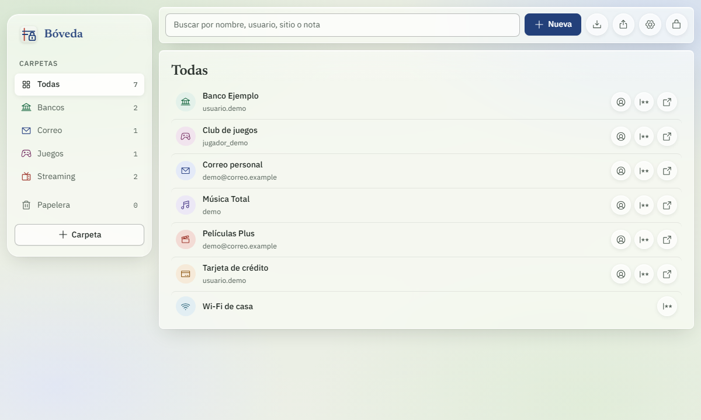
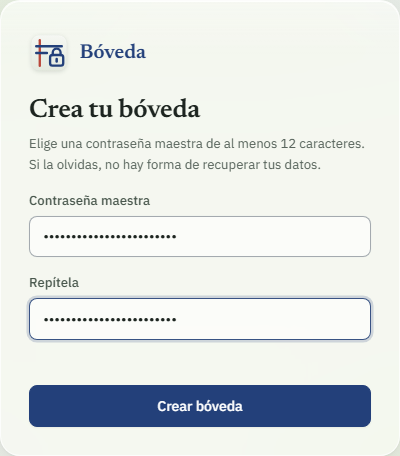
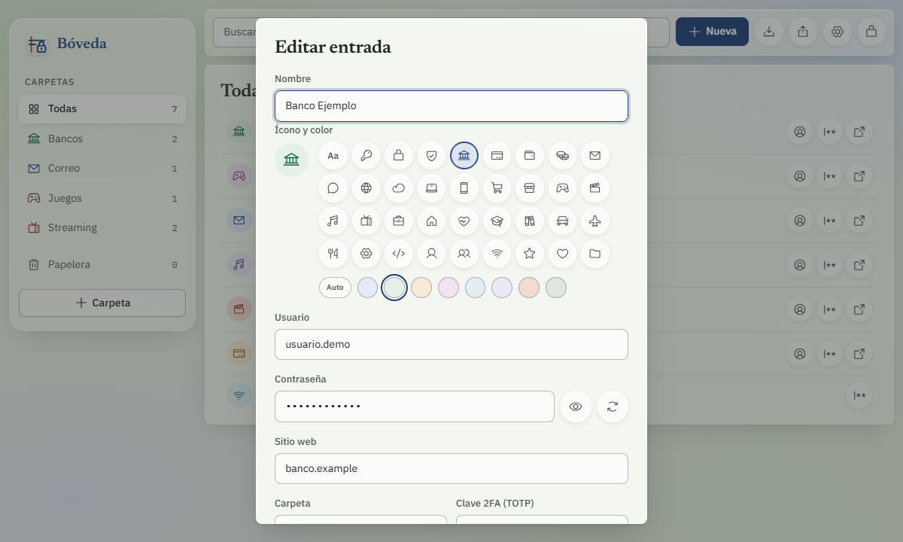
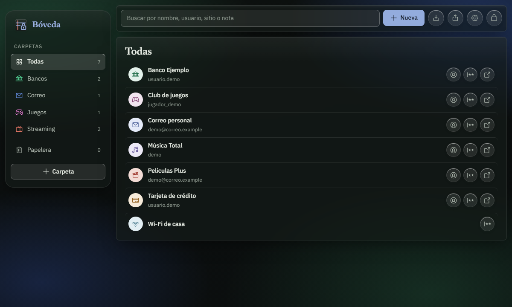
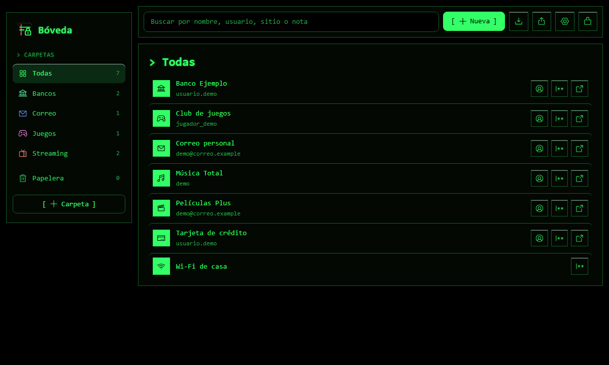

# Bóveda

**Gestor de contraseñas local para Windows.** Tus contraseñas se guardan cifradas en **un solo archivo en tu computadora**: sin nube, sin cuentas, sin suscripciones y sin instalar nada.



- 🔐 **Cifrado fuerte:** AES-256-GCM con una llave derivada de tu contraseña maestra (PBKDF2-SHA256, 600 000 iteraciones).
- 🪟 **Windows Hello:** entra con tu PIN, huella o cara.
- 🗂️ **Carpetas e íconos:** organiza con carpetas y elige ícono y color para cada entrada y carpeta.
- 🗑️ **Papelera de 30 días:** lo que borras se puede recuperar durante un mes.
- 📥📤 **Importa y exporta CSV:** compatible con Bitwarden, Chrome, Edge y Firefox.
- 🎨 **Personalizable:** temas Papel de vidrio claro, oscuro, «según Windows» y Terminal, color de acento, tamaño de letra, esquinas, bloqueo automático y generador de contraseñas.
- 💼 **Portátil y ligera:** un solo `.exe` de unos 3 MB, hecho con [Tauri](https://tauri.app). Llévalo en una USB junto con tu bóveda.

> **Próximamente disponible para Linux y Android.**

---

## Descargar

1. Ve a **[Releases](https://github.com/Dami-Val/boveda-local/releases/latest)** y descarga `Boveda-…-windows-portable.zip`.
2. Descomprímelo en una carpeta tuya, por ejemplo `Documentos\Boveda`.
3. Abre **`Boveda.exe`**.

**Requisitos:** Windows 10 u 11 con **WebView2**, que ya viene incluido en Windows 11 y en Windows 10 actualizado. Si la app no abre, instala el [WebView2 Runtime](https://developer.microsoft.com/microsoft-edge/webview2/) de Microsoft. No hace falta nada más.

**¿Vienes de la versión 1?** Copia tu `boveda.json` (y `hello.dat`, si lo tienes) junto al nuevo `Boveda.exe`. El formato es el mismo.

> **Windows SmartScreen** puede mostrar «Windows protegió tu PC» porque el programa no está firmado. Haz clic en **Más información → Ejecutar de todas formas**. Si lo prefieres, puedes [compilarlo tú](#compilar-desde-el-código).

---

## Guía de uso

### 1. Crea tu bóveda

La primera vez te pedirá una **contraseña maestra** de al menos 12 caracteres.



> ⚠️ **La contraseña maestra no se puede recuperar.** Es la llave del cifrado: si la olvidas, nadie (ni siquiera el programa) puede abrir tu bóveda. Anótala en papel y guárdala en un lugar seguro.

### 2. Agrega tus contraseñas

- **Nueva:** botón azul **+ Nueva**. Llena nombre, usuario, contraseña, sitio web, carpeta y notas.
- **Generar:** el ícono 🔄 junto a la contraseña crea una contraseña segura. Su longitud y tipos de caracteres se ajustan en **Ajustes**.
- **Ícono y color:** elige uno de los 35 íconos (o las iniciales) y un color de fondo. La vista previa grande muestra cómo se verá.



### 3. Úsalas en el día a día

En cada fila tienes tres botones:

| Botón | Qué hace |
| --- | --- |
| 👤 | Copia el **usuario** |
| `\|**` | Copia la **contraseña**. El portapapeles se borra solo después de 30 segundos (configurable) |
| ↗ | Abre el **sitio web** en tu navegador de siempre |

Haz clic en el nombre de una entrada para **editarla**. Usa la barra de **búsqueda** para filtrar por nombre, usuario, sitio o notas.

### 4. Organiza con carpetas

- **+ Carpeta** en el panel izquierdo crea una carpeta con su ícono y color.
- Al abrir una carpeta aparecen ✏️ **Editar** (nombre, ícono y color) y 🗑️ **Eliminar**. Al eliminar una carpeta, sus entradas **no se borran**: quedan sin carpeta.
- Para mover una entrada, edítala y cambia el campo **Carpeta**. También puedes escribir el nombre de una carpeta nueva.

### 5. Papelera

**Mover a la papelera** (dentro del editor) no borra nada de inmediato: la entrada pasa a **Papelera**, donde puedes **restaurarla** o **borrarla definitivamente**. Lo que lleva **30 días** en la papelera se borra solo.

### 6. Importar y exportar

| Ícono | Acción |
| --- | --- |
| ⬇ **Importar CSV** | Acepta los CSV exportados de **Bitwarden, Chrome, Edge y Firefox**. Omite duplicados y crea las carpetas que vengan en el archivo |
| ⬆ **Exportar CSV** | Pide tu contraseña maestra y guarda `boveda-AAAA-MM-DD.csv` en **Descargas**, en formato Bitwarden (lo leen Bitwarden, 1Password, Proton Pass y la misma Bóveda) |

> ⚠️ Un CSV **no está cifrado**: cualquiera que lo abra ve tus contraseñas. **Bórralo** (y vacía la papelera de Windows) en cuanto termines de usarlo.

### 7. Windows Hello (PIN, huella o cara)

1. **Ajustes ⚙ → Activar Windows Hello**.
2. Confirma tu contraseña maestra y luego tu PIN, huella o cara.
3. Desde ahí, en la pantalla de bloqueo aparece **Entrar con Windows Hello**. Tu contraseña maestra sigue funcionando.

Si cambias la contraseña maestra, Windows Hello se desactiva y lo vuelves a activar en Ajustes.

### 8. Personaliza

En **Ajustes ⚙** puedes cambiar el tema, el color de acento, el tamaño de letra, el redondeo de las esquinas, los minutos para el **bloqueo automático**, los segundos para **borrar el portapapeles**, el orden de la lista, las opciones del **generador** y la **contraseña maestra**.

| Papel de vidrio oscuro | Terminal |
| --- | --- |
|  |  |

El ícono 🔒 de la barra superior **bloquea** la bóveda al instante. Al cerrar la ventana, el programa se apaga por completo.

---

## Tus datos y respaldos

Todo vive junto a `Boveda.exe`:

| Archivo | Qué es |
| --- | --- |
| `boveda.json` | **Tu bóveda cifrada.** Respáldala (en una USB o en la nube): sin tu contraseña maestra es ilegible |
| `boveda.json.bak` | La versión anterior a tu último cambio, por si algo sale mal |
| `hello.dat` | Solo si activaste Windows Hello: la llave protegida con tu cuenta de Windows. No sirve en otra PC |

**Para pasarte a otra computadora:** copia `Boveda.exe` y `boveda.json` a la misma carpeta en la otra PC y entra con tu contraseña maestra (Windows Hello se activa de nuevo allá).

## Seguridad: cómo funciona

- El cifrado y el descifrado ocurren **dentro de la ventana de la app** (WebCrypto). El disco solo recibe datos ya cifrados.
- `Boveda.exe` es una app nativa hecha con **Tauri**. No abre puertos ni servidores: la interfaz habla con la parte nativa (Rust) solo por el canal interno de Tauri, y la página usa una política CSP estricta. Solo puede haber **una instancia** abierta a la vez.
- Cada guardado es **atómico** (se escribe a un temporal y se renombra), así que un corte de luz no deja el archivo a medias.
- **Windows Hello** guarda la llave protegida con **DPAPI** (tu cuenta de Windows) y solo la entrega tras verificar tu PIN, huella o cara. Es el mismo nivel de protección que las contraseñas guardadas en Chrome o Edge. Si te preocupa que un programa malicioso corra con tu sesión, deja Windows Hello desactivado.
- La app se **bloquea sola** tras unos minutos sin uso.

**Límites conocidos:** no hay autocompletado en el navegador ni extensión; la clave 2FA (TOTP) se guarda, pero aún no se generan los códigos de 6 dígitos.

## Preguntas frecuentes

**Olvidé mi contraseña maestra.** No hay forma de recuperarla. Si quieres empezar de cero, cierra la app, renombra `boveda.json` (por ejemplo a `boveda.json.antigua`) y vuelve a abrirla.

**Abro el `.exe` y solo aparece la ventana que ya tenía.** Es a propósito: solo puede haber una Bóveda abierta. Si acabas de actualizar, cierra la ventana y vuelve a abrir el `.exe`.

**¿Por qué pesa tan poco?** Usa **WebView2**, el motor web que ya trae Windows, en lugar de llevar un navegador completo adentro.

---

## Compilar desde el código

Necesitas [Node.js](https://nodejs.org) 22 o superior, [Rust](https://rustup.rs) y los [requisitos de Tauri para Windows](https://tauri.app/start/prerequisites/) (las herramientas de C++ de Visual Studio).

```bash
npm install                       # instala la CLI de Tauri
npm test                          # pruebas de cifrado, CSV, papelera y generador
cd src-tauri && cargo test        # pruebas del guardado y de DPAPI
npm run dev                       # abre la app en modo desarrollo
npm run construir                 # genera src-tauri/target/release/boveda.exe
```

| Archivo | Qué contiene |
| --- | --- |
| `public/vault.js` | Cifrado, lectura y escritura de CSV, generador y papelera (código puro, probado en `test.mjs`) |
| `public/app.js` · `public/index.html` | Interfaz |
| `public/iconos.js` | Íconos Phosphor |
| `src-tauri/src/lib.rs` | Parte nativa: guardado atómico junto al `.exe`, Windows Hello con DPAPI, abrir sitios, exportar a Descargas y una sola instancia |
| `src-tauri/tauri.conf.json` | Ventana, CSP e íconos |

Variable solo para desarrollo: `BOVEDA_DIR`, para guardar la bóveda en otra carpeta.

## Hoja de ruta

- 🐧 **Linux:** próximamente (Tauri ya lo permite; falta adaptar el desbloqueo biométrico).
- 🤖 **Android:** próximamente (Tauri 2 lo permite).
- Códigos 2FA (TOTP) en la app.

## Créditos

Estilo visual «Papel de vidrio». Fuentes IBM Plex y Newsreader (SIL OFL 1.1) e íconos Phosphor (MIT): ver [licencias](licencias/README.md).
